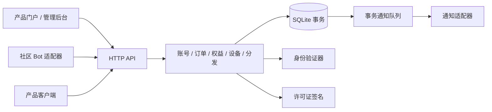

# 架构与业务规则

## 范围

本框架服务于多个可配置产品。HTTP API 和 SQLite 是首个参考部署；业务入口为 `Framework`。`src/core` 保存可独立测试的策略和签名逻辑，身份与通知通过接口扩展。当前事务层仍使用 SQLite SQL，不承诺 PostgreSQL 无修改替换。

## 对象边界

- `account` 是内部稳定 ID；外部身份为唯一的 `(provider, subject)`。用户不能自行改这个绑定。
- `product` 是产品；`edition` 是收费版本；`releaseId` 是具体构建。三者与 Git 分支无关。
- `entitlement` 表示账号对收费版本的永久权益。升级增加目标权益，不删除来源权益。不自动赠送未购买的中间版本。
- `offer` 是明确定价的商品。金额采用最小货币单位整数；升级有明确来源版本资格。历史实付金额不参与固定升级价。
- `device group` 决定共享设备的范围。相同组中的所有产品和版本共用一台绑定电脑、冷却时间和额外次数。
- `distribution` 记录一次用户文件发放。水印、文件哈希与许可身份不能互相替代。

## 历史授权与发布渠道

0.2.0 提供宿主专用的 `importEntitlement`：先由可信平台核实身份与证据，再按来源、凭证、版本记账；不伪造订单，不覆盖付费来源，不恢复撤销权益。历史权益的 `order_id` 可为空，来源与渠道分别保存。

Beta 资格包含同版本普通版，普通版权益不含 Beta，升级不继承旧版 Beta。宿主通过 `hasReleaseAccess` 做实际交付渠道检查；当前设备许可证不携带渠道条件。最低升级商品通过 `bestUpgradeOffer` 在有效旧权益对应的固定报价中选择，拒绝混合币种。

完整边界见 [系统手册](SYSTEM-GUIDE.md) 和 [接入指南](INTEGRATION.md)。

## 设备规则

首次激活启动冷却，不扣次数。最近一次首次激活或成功换绑时间加 `cooldownMonths`，得到 `free_at`。成熟的免费资格持续保留，不累积多次。付费或管理员次数可以突破冷却，成功使用后同样重算 `free_at`。购买次数不改冷却；免费可用时优先使用免费资格。

同一设备公钥重新验证不属于换绑，不重算冷却。公钥丢失后不能仅凭 HWID 自动恢复；使用经验证的账号完成新设备激活，并按换绑规则处理。支持人员可发放例外次数。

月份使用配置中的固定 UTC 偏移计算，保留本地时分秒并对月底夹取有效日期。示例为 UTC+08:00。首版未支持具有夏令时变化的 IANA 时区。

设备挑战必须先证明私钥持有。新旧绑定替换、额度消耗、挑战使用、审计和通知在一个 `BEGIN IMMEDIATE` 事务内提交；失败整体回滚。HTTP 重试使用幂等键，重复命令不产生重复效果。

## 付款与授权

人工核实从真实收款记录开始，不接受付款截图或浏览器成功跳转作为付款证明。管理员输入渠道、流水号、金额、币种，后台匹配订单快照并检查 `(method, reference)` 唯一性。当前假设每种渠道只有一个收款账户；多商户部署需要将收款账户纳入流水唯一键。

重复确认相同流水返回既有结果；不同流水确认已支付订单产生冲突。两个独立订单重复购买同一版本时，后确认的订单不再次发权益，需人工处理多付金额。撤销权益不会自动退款，也不默认撤销后续升级权益；退款及升级依赖撤销应由业务方明确实现。

## 永久权益与短期许可证

数据库中的版本权益没有到期字段。许可证为默认 15 分钟的签名租约，带账号、产品、收费版本、设备、公钥指纹与绑定代次。申请许可证时再次检查当前绑定和权益。旧设备不能刷新，但已发放许可证可能持续到期。短期凭据不表示重新收费。

暂停服务会影响许可证刷新。生产产品应在销售规则中明确离线容忍及服务退出方案。许可证不是不可破解的 DRM；不能阻止有能力修改本地程序的人绕过本地执行判断。

## 事务通知

关键操作和 outbox 写入同一事务，消息失败不回滚付款或权益。`dispatchNotifications` 是单 worker、至少一次投递，崩溃重试可能重复通知。适配器可按事件 ID 去重；KOOK 接口不保证此类去重。多 worker 部署需增加持久任务租约和退避；不要并发调用当前参考 dispatcher。

## 身份恢复

管理员更改外部身份时撤销现有会话、待处理挑战和相关邀请，禁用设备刷新，保留冷却和分发时的身份历史。新身份验证成功后，可无额外换绑成本重新验证相同设备密钥；使用新密钥则按换绑规则处理。管理员应先通过独立证据验证找回请求，并审计操作原因。
